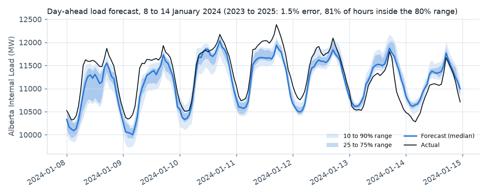
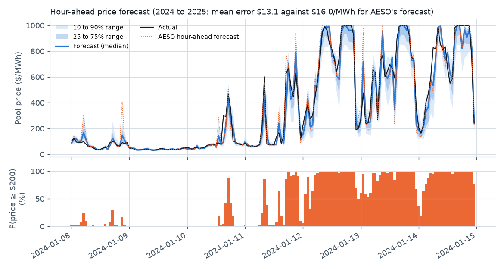
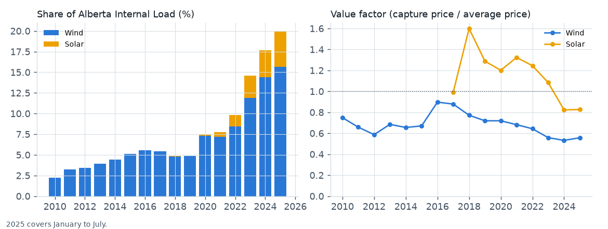
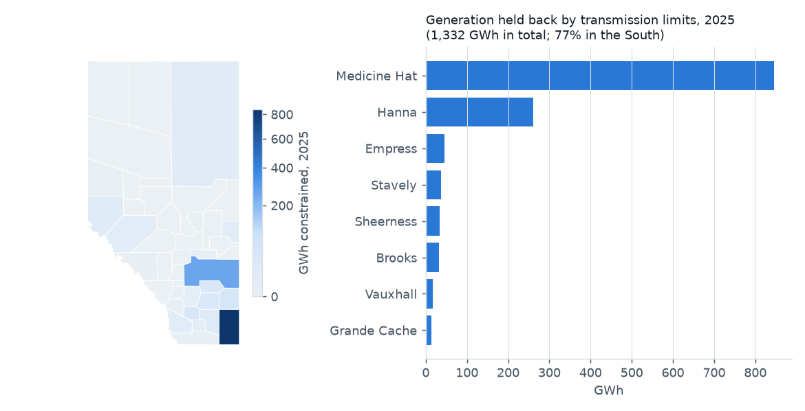

# Alberta grid analytics

Probabilistic forecasts of Alberta's load and pool price tested on unseen years, the value of wind and solar as their share grows, and a congestion screen ahead of locational pricing. Built on 15 years of hourly public data from the Alberta Electric System Operator (AESO).

**[Interactive dashboard](https://onyichuks.github.io/alberta-grid-analytics/)** · [Executive summary](docs/EXECUTIVE_SUMMARY.md) · [Research report](docs/REPORT.md) · [Machine learning note](docs/ML_TECHNICAL_NOTE.md) · [About the data](docs/DATASET.md)

## Objective

Build the analysis a grid analytics team needs as the system changes:
* operational forecasts that state their uncertainty honestly;
* a measure of what renewable growth does to prices and flexibility;
* an early view of where transmission limits bind, ahead of locational marginal pricing.

Every result is tested on years the models never saw and reproduced from public data.

## Results

| | Result |
|---|---|
| Day-ahead load forecast, 2023 to July 2025 | **1.48%** mean absolute percentage error (benchmark 2.99%); **81%** of hours inside the 80% range after conformal calibration (63% before) |
| Hour-ahead price forecast, 2024 to July 2025 | Mean error **$13.11/MWh** against $15.96 for AESO's hour-ahead forecast (18% lower); quantile loss 34% lower |
| Price spike warning ($200/MWh or more) | Brier skill **69%**; catches 76% of spikes with 20% false alarms (AESO forecast as a flag: 80% and 31%) |
| Wind value factor | 0.71 (2019 to 2021) to **0.55** (2023 to 2025) as wind's share of load rose from 4.8% to 14.4% |
| Generation held back by transmission limits | 116 GWh (2020) to **1,332 GWh** (2025); Medicine Hat 63% and the South 77% of the 2025 total |
| Net load flexibility | 99th percentile three-hour rise from 1,099 MW (2022) to 1,548 MW (2025) |

The [machine learning note](docs/ML_TECHNICAL_NOTE.md) shows how the models were trained and checked: training and learning curves, linear baselines with the same inputs, where the errors are (including the weak spots), and what drives each forecast.






## Conclusions

1. **Load.** Day-ahead load can be forecast to within about 1.5 percent with calibrated ranges, provided the model follows load growth (relative target, yearly retraining) and is recalibrated each year. A single test year hid a drift that reached 235 MW.
2. **Price.** A probabilistic layer on AESO's hour-ahead price forecast reduces its error and adds a spike probability that is reliable at the low and high ends.
3. **Renewable value.** Wind and solar are cannibalizing their own prices; batteries earned 5.5 times the average price in 2024.
4. **Congestion.** Constraints are concentrated in a few exporting areas (Medicine Hat, Hanna, Sheerness), where locational prices would most likely separate from the system price first.

## Ask the analysis with an AI agent

`src/gridanalytics/mcp_server.py` is a read-only [Model Context Protocol](https://modelcontextprotocol.io) server. It exposes seven tools:
* grid summary;
* forecast scores;
* forecast for a given hour;
* constrained energy;
* area balance;
* asset value;
* annual summary.

An AI assistant can then answer questions like "how much wind was held back near Medicine Hat in 2025?" or "what did the forecast say for 6 pm on 13 January 2024?". Every answer names its source table. To try it:

```
pip install -r requirements.txt
python scripts/try_mcp.py             # starts the server, lists the tools, asks three questions
```

To connect it to an MCP client, add an entry like this to the client's server configuration (adjust the path):

```json
{
  "mcpServers": {
    "alberta-grid-analytics": {
      "command": "python",
      "args": ["-m", "gridanalytics.mcp_server"],
      "env": {"PYTHONPATH": "C:/path/to/alberta-grid-analytics/src"}
    }
  }
}
```

## Repository

```
src/gridanalytics/   data loading, asset types, quality checks, forecasting, renewables, congestion,
                     agent tools and the MCP server
scripts/             get_data, prepare_data, check_data, build_dashboard, make_figures, try_mcp
run_forecast.py      load and price forecasts with yearly retraining and conformal intervals
run_market.py        wind and solar value, ramps, AESO wind forecast, congestion screen, interties
run_ml_analysis.py   machine learning checks: training and learning curves, linear baselines, error breakdown
outputs/             results (JSON) and tables (CSV)
dashboard/, docs/    dashboard template; built dashboard (GitHub Pages), report, summary, machine learning note, data notes
static_data/         asset list, weather, planning area map
tests/               unit tests (pytest)
```

## Reproduce

```
pip install -r requirements.txt
python scripts/get_data.py
python scripts/prepare_data.py
python scripts/check_data.py
python run_forecast.py
python run_market.py
python run_ml_analysis.py          # optional: the machine learning note (about 40 minutes)
python scripts/build_dashboard.py
python scripts/make_figures.py
python scripts/make_ml_figures.py
pytest
```

The raw AESO files are not stored here; `get_data.py` downloads them and checks their SHA-256 checksums.

## Data and use

Data comes from the Alberta Electric System Operator (public data requests and the Current Supply and Demand report). Temperature comes from ERA5 (Copernicus Climate Change Service) through Open-Meteo, CC BY 4.0. AESO material is used for non-commercial, educational purposes under the AESO website terms. This is an independent project, not affiliated with or endorsed by the AESO. Code is under the MIT License.
