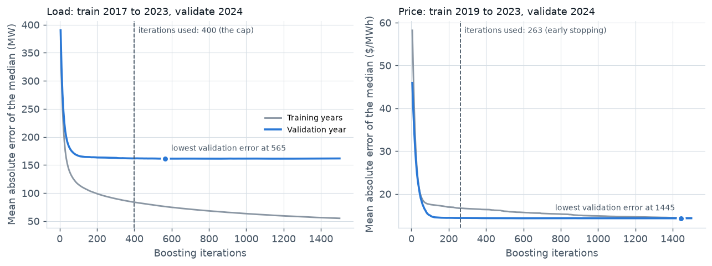
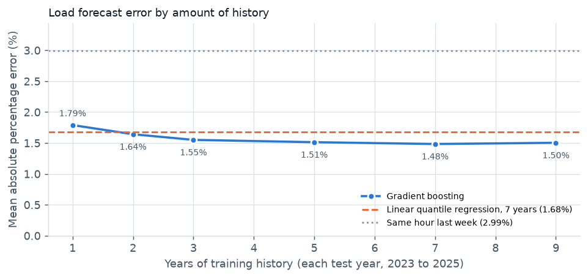
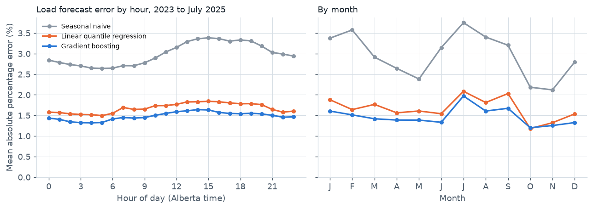
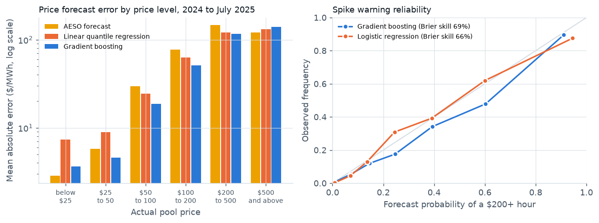

# Machine learning technical note: Alberta load and price forecasts

Onyi Chuks, Calgary, Alberta. October 2026. [Interactive dashboard](https://onyichuks.github.io/alberta-grid-analytics/) · [Research report](REPORT.md) · [Executive summary](EXECUTIVE_SUMMARY.md) · [Code](https://github.com/onyichuks/alberta-grid-analytics)

## 1. Summary

This note goes behind the forecasts in the [research report](REPORT.md): how the gradient-boosted models were trained and checked, whether they earn their complexity against linear models built from the same data, and where they fall short. The new results come from `run_ml_analysis.py` and are stored in `outputs/ml_results.json` and `outputs/tables/m01` to `m07`; the largest single miss, quoted from the report, comes from `outputs/forecast_results.json`.

* **Against linear models.** With the same data and the same calibration, the boosted load forecast has **12 percent lower error** than linear quantile regression modelled on the standard competition benchmark (1.48 against 1.68 percent). The boosted price forecast has **25 percent lower error** ($13.11 against $17.42/MWh).
* **History.** Load error falls from 1.79 percent with one year of training data to 1.48 percent with seven, then levels off. More history also buys narrower ranges at the same coverage.
* **Training behaviour.** The median models barely change with the number of boosting iterations or across the nine settings tried (all within 3.2 percent of the best). The load tail models overfit slightly at the 400 iterations used.
* **Weak spots.** Below -20 C the load ranges hold only 64 percent of hours against 80 percent intended, with the misses concentrated in two cold spells (February 2023 and the January 2024 cold snap). Above $500/MWh the price model misses by more than AESO's own forecast. Fixes are listed in section 12.
* **Spike warning.** The boosted classifier beats logistic regression on every score (Brier skill 69 against 66 percent), but its middle-range probabilities run high.

## 2. Problem set-up

| | Day-ahead load | Hour-ahead price | Spike warning |
|---|---|---|---|
| Target | Alberta Internal Load (MW), each hour | Pool price ($/MWh), each hour | Price at or above $200/MWh (yes or no) |
| Issued | Morning of the day before | One hour before delivery | One hour before delivery |
| Output | 10th, 25th, 50th, 75th and 90th percentiles | Same five percentiles | Probability |
| Inputs | Calendar, temperature in Calgary and Edmonton, load 48 to 336 hours earlier | Recent prices, load, wind, solar and thermal output, imports, temperature, calendar, AESO's hour-ahead forecast | Same as price |
| Training | 7 years ending two years before the test year | 5 years ending two years before | 6 years ending the year before |
| Calibration | The year before the test year | The year before | None (probabilities scored directly) |
| Test | 2023, 2024, January to July 2025 | 2024, January to July 2025 | 2024, January to July 2025 |

**Leakage controls.**
* Every load input is at least 48 hours old at the target hour. Every price input is at least one hour old, except the temperature for the delivery hour and AESO's hour-ahead forecast for that hour, which AESO publishes before it. A unit test (`test_features_do_not_leak_the_target`) changes the load and price in one hour and checks that the features for that hour do not move, and that the load level only reacts 48 hours later.
* Temperature is the ERA5 reanalysis value for the hour, standing in for a weather forecast. It is the one input not available in real time, and it makes the scores somewhat optimistic, most of all for the day-ahead load forecast.
* Test years were not used to tune any setting or threshold. They did shape one design change: the first version drifted low as Alberta's load grew through the test years, which led to the relative target and yearly retraining (report section 4.2; the first attempt is kept in the report's comparison). The training curves (section 5, validated on 2024), the learning curve (section 6), the error breakdown (section 8) and the input importance (section 9) use test years, but only to describe the chosen model; nothing was changed because of them.

## 3. Models

**Gradient-boosted quantile trees.** scikit-learn's histogram gradient boosting (Friedman, 2001; Pedregosa et al., 2011), one model per percentile, each fitted with the pinball loss for its percentile (Koenker and Bassett, 1978). Settings, the same for load and price:

| Setting | Value |
|---|---|
| Learning rate | 0.06 |
| Maximum iterations | 400 |
| Maximum leaves per tree | 48 |
| Minimum hours per leaf | 60 |
| L2 regularization | 1.0 |
| Early stopping | scikit-learn's default for more than 10,000 rows: a random 10 percent of the training hours is held out and training stops after 10 rounds without improvement |

The spike classifier is the same method with the log loss, up to 300 iterations, 32 leaves per tree and at least 80 hours per leaf.

**Two design choices for load.** Trees cannot predict outside the range of their training targets, and Alberta's load grew beyond it. The load models therefore predict load divided by its average over the week ending 48 hours earlier, and multiply back. They are retrained every year.

**Crossing and calibration.** Percentiles that cross are sorted into order (Chernozhukov et al., 2010). Each interval is then widened by the smallest amount that would have made it hold on the calibration year (conformalized quantile regression; Romano et al., 2019).

**Linear baselines, built from the same data, with the same calibration.**
* Load: linear quantile regression (statsmodels; Seabold and Perktold, 2010) on a design modelled on the "vanilla" benchmark of the Global Energy Forecasting Competitions (Hong, 2010; Hong et al., 2014). It predicts the same relative load target from hour by day type (weekday, or weekend and holiday), month, a cubic in the average of the two cities' temperatures with month and hour interactions, the daily mean temperature and its square, and the same recent-load inputs: 170 columns in all. Unlike the boosted model it does not use the 24-hour lagged temperature, the day-of-year terms, each city separately, or day of week beyond the weekend flag.
* Price: linear quantile regression on the boosted model's inputs, with hour of day as categories in place of the numeric hour, and without day of week and month (day of year, holiday and weekend flags are kept).
* Both linear models are fitted by iteratively reweighted least squares. Where that did not converge within 3,000 iterations, the exact linear programme was solved instead with HiGHS (Huangfu and Hall, 2018). All 15 load models converged; 6 of the 10 price models needed the exact solver, all for percentiles other than the median, most likely because of the heavy tails of prices.
* Spike warning: logistic regression on standardized inputs.

## 4. Validation design

* **Rolling origin.** Each test year is forecast by models trained only on earlier years, as an operator retraining every January would do. Load is tested on three years and price on two.
* **Calibration year.** The year between training and test is used only to size the conformal adjustment.
* **Settings check.** Section 5 compares nine combinations of learning rate and tree size on years before the test period: training 2015 to 2021 and validating on 2022 for load, training 2018 to 2022 and validating on 2023 for price.
* **Scores.** Mean absolute percentage error (load) or mean absolute error (price) of the median, mean pinball loss over the five percentiles (a proper score for quantile forecasts; Gneiting and Raftery, 2007), and the share of hours inside the 10 to 90 and 25 to 75 percent ranges. The spike warning is scored with the Brier score (Brier, 1950), the area under the ROC curve and average precision, and checked with a reliability table.

## 5. Training behaviour



The 10th, 50th and 90th percentile models for 2025 were retrained with early stopping switched off and scored at every 5th iteration, on a random 20,000-hour sample of their training years and on all of 2024, a year they were not trained on (load: train 2017 to 2023; price: train 2019 to 2023). The figure shows the median models; the table covers all three. The iterations used in production are those of the actual 2025 models.

| Model | Iterations used in production | Lowest error on 2024 at | Error at 400 against the lowest | Error at 1,500 against the lowest |
|---|---|---|---|---|
| Load, median | 400 (the cap) | 565 | 0.4 percent higher | 0.3 percent higher |
| Load, 10th percentile | 400 (the cap) | 140 | 3.1 percent higher | 11.9 percent higher |
| Load, 90th percentile | 400 (the cap) | 190 | 4.0 percent higher | 14.5 percent higher |
| Price, median | 263 | 1,445 | 0.2 percent higher | 0.1 percent higher |
| Price, 10th percentile | 260 | 185 | 0.7 percent higher | 3.8 percent higher |
| Price, 90th percentile | 192 | 500 | 0.1 percent higher | 0.6 percent higher |

(Error is the pinball loss for that percentile on 2024.)

**What the curves show.**
* **The median models are not sensitive to the number of iterations.** For load the 2024 error stays within 0.5 percent of its lowest anywhere from 400 to 1,500 iterations, while the training error keeps falling (mean absolute error 84 MW at 400 iterations, 55 MW at 1,500). The growing gap between the two curves is detail that does not carry to a new year, but it does little harm to the median.
* **The load tail models overfit.** The 10th and 90th percentile models are best at 140 to 190 iterations and are 3 to 4 percent worse at the 400 used. A tail percentile is decided by the few hours beyond it, so its model runs out of real signal sooner and starts fitting noise.
* **Early stopping did not trigger in any load model whose iterations were recorded** (the five 2025 models and the nine in the settings check). It holds out a random 10 percent of training hours. Each of those hours probably sits between training hours that are very similar, so the held-out error keeps improving and training runs to the 400 cap; this explanation was not tested directly. For the 2025 price models it stopped at 192 to 305 iterations, perhaps because neighbouring hours of price are less alike.
* **The conformal step corrects the coverage, not the overfitting.** It widens the ranges until they hold on the calibration year, so coverage is right (section 10), but overfitted tails mean the ranges are likely a little wider than they need to be. Stopping each tail model on a time-ordered validation year is the first improvement listed in section 12.
* For the price median, the training error is above the 2024 error throughout, because the training years include the far more volatile 2021 to 2023 market.

**Settings check.** Nine combinations of learning rate (0.03, 0.06, 0.12) and leaves per tree (16, 48, 128), scored on years before the test period:

| | Load (validate 2022) | Price (validate 2023) |
|---|---|---|
| Settings used (0.06, 48 leaves) | 1.660 percent | $34.07/MWh |
| Best of the nine | 1.655 percent (0.03, 128 leaves) | $33.91/MWh (0.12, 128 leaves) |
| Used against best | 0.3 percent higher | 0.5 percent higher |
| Range across all nine | 1.655 to 1.708 percent | $33.91 to $34.44/MWh |

The median forecast barely changes across these nine settings: every combination is within 3.2 percent of the best for load and 1.6 percent for price. This check covers the median models and one validation year only; section 5 shows the tail models are more sensitive, to the number of iterations at least.

## 6. How much history the load model needs



Each test year was forecast again with models trained on the 1 to 9 years before it (same calibration year).

| Years of training | MAPE | Inside 80% range, raw | Inside 80% range, after calibration | 80% range width (MW) |
|---|---|---|---|---|
| 1 | 1.79% | 40.3% | 81.3% | 592 |
| 2 | 1.64% | 48.4% | 81.1% | 533 |
| 3 | 1.55% | 55.2% | 81.8% | 516 |
| 5 | 1.51% | 58.7% | 80.7% | 498 |
| **7 (used)** | **1.48%** | **62.7%** | **81.2%** | **496** |
| 9 | 1.50% | 64.7% | 80.1% | 490 |

(With one year of history, under 10,000 hours, scikit-learn switches early stopping off; the other rows use it, as in production.)

* **Error levels off after about five years.** Two years of history already beat the 7-year linear model (1.64 against 1.68 percent). Nine years are no better than seven, most likely because the oldest years describe a smaller, differently shaped load.
* **Less history makes the raw ranges far too narrow.** With one year, only 40 percent of hours fall inside the raw 80 percent range. The conformal step brings every case to about 81 percent, but by widening the range: 592 MW with one year against 496 MW with seven. More history buys narrower ranges at the same coverage, not just a better median.

## 7. Against linear models

**Load (2023 to July 2025, 22,631 hours).**

| Model | MAPE | Pinball loss | Inside 80% range, raw | Inside 80% range, calibrated | 80% range width (MW) |
|---|---|---|---|---|---|
| Same hour last week | 2.99% | 109.3 | 72.9% | not calibrated | 810 |
| Linear quantile regression | 1.68% | 59.5 | 76.1% | 80.5% | 545 |
| **Gradient boosting** | **1.48%** | **53.2** | 62.7% | **81.2%** | **496** |

* The boosted model's error is 12 percent lower than the linear model's and its quantile loss 11 percent lower. It is better in each test year (1.41, 1.58 and 1.45 percent against 1.59, 1.80 and 1.62 percent).
* After calibration both models hold their ranges, but the boosted ranges are 9 percent narrower for the same coverage.
* The linear model is the better calibrated before the conformal step (76 against 63 percent inside the raw range), likely because it is simpler and fits the training years less closely.
* The vanilla design is a strong benchmark: it already nearly halves the error of the naive method. The boosted model's advantage over it is broad rather than confined to a few conditions: it is better in every hour of the day and in 11 of the 12 months (section 8).

**Price (2024 to July 2025, 13,871 hours).**

| Model | Mean absolute error ($/MWh) | Pinball loss | Inside 80% range, raw | Inside 80% range, calibrated |
|---|---|---|---|---|
| AESO hour-ahead forecast with its error spread | 15.96 | 7.46 | 73.7% | not calibrated |
| Linear quantile regression with AESO's forecast as an input | 17.42 | 6.42 | 43.5% | 78.2% |
| **Gradient boosting with AESO's forecast as an input** | **13.11** | **4.96** | 61.9% | **84.0%** |

* A linear model given the same data, including AESO's forecast, does worse than AESO's forecast on the median ($17.42 against $15.96). Its quantiles already beat AESO's spread on quantile loss before calibration (6.72 against 7.46), despite holding only 43 percent of hours in the raw 80 percent range; the conformal step brings coverage to 78 percent.
* The boosted model's error is 25 percent lower than the linear model's and its quantile loss 23 percent lower. A likely reason is that prices respond to scarcity in sharp steps (offers stack up, then jump), which trees can follow and a straight line cannot.

## 8. Where the errors are



**Load.**
* **By hour:** error is lowest overnight (1.3 percent from 3 to 6 am) and highest in the afternoon (1.6 percent from 2 to 4 pm). The boosted model beats the linear model in every hour.
* **By month:** July is the hardest month for every method (1.97 percent for the boosted model); it includes the largest single miss, an over-forecast of about 1,100 MW on the afternoon of 25 July 2024. October and November are the easiest. In October the linear model is marginally better (1.18 against 1.20 percent), the only month it wins.
* **By day type:** holidays are hardest (1.63 percent against 1.51 on weekdays and 1.40 on weekends), as there are only about 25 holiday days in the test years.
* **By temperature:**

| Average of Calgary and Edmonton temperature | Hours | MAPE, boosted | MAPE, linear | Inside 80% range, boosted | Inside 80% range, linear | Bias, boosted (MW) |
|---|---|---|---|---|---|---|
| Below -20 C | 685 | 1.64% | 2.06% | **63.5%** | 75.6% | -87 |
| -20 to -10 C | 1,936 | 1.43% | 1.69% | 81.0% | 80.7% | -32 |
| -10 to 0 C | 5,154 | 1.41% | 1.58% | 82.2% | 82.2% | -24 |
| 0 to 10 C | 6,435 | 1.37% | 1.56% | 84.0% | 81.6% | -12 |
| 10 to 20 C | 6,127 | 1.57% | 1.77% | 81.7% | 79.2% | +47 |
| Above 20 C | 2,294 | 1.76% | 1.89% | 75.1% | 78.6% | -17 |

(Bands include their upper limit, so "below -20 C" includes the 3 hours at exactly -20 C.)

The boosted median stays more accurate than the linear one even in the coldest hours (and the linear model under-forecasts them by more: 131 against 87 MW), but the boosted ranges are too narrow there: only 64 percent of the hours below -20 C fall inside the 80 percent range. The training years are not short of cold hours (3.5 to 4.2 percent of them are at or below -20 C, against 3.0 percent of test hours). The misses come from a few cold spells:
* **February 2023:** 81 hours below -20 C, of which only 15 percent fell inside the range, with load under-forecast by about 390 MW on average.
* **The January 2024 cold snap,** the coldest spell in the 2010 to 2025 data: 176 hours, 49 percent inside. For 50 hours between 12 and 15 January the temperature was below anything in the training years, and only 36 percent of those were inside.
* **2025:** 291 cold hours, 83 percent inside, as intended.

This matters, because extreme cold is when the grid is tightest. The warmest hours, above 20 C, are also slightly under-covered (75 percent). Section 12 lists fixes.



**Price.**

| Actual pool price | Hours | AESO forecast | Linear | Boosted |
|---|---|---|---|---|
| Below $25 | 5,958 | **2.86** | 7.38 | 3.66 |
| $25 to 50 | 5,113 | 5.76 | 8.98 | **4.59** |
| $50 to 100 | 1,608 | 29.59 | 24.49 | **18.79** |
| $100 to 200 | 590 | 76.89 | 62.78 | **51.03** |
| $200 to 500 | 355 | 146.68 | 120.29 | **116.89** |
| $500 and above | 247 | **120.74** | 131.88 | 140.49 |

(Mean absolute error of the median, $/MWh. Bands include their upper limit, so the 2 hours at exactly $200 sit in the $100 to 200 band; that is why the top two bands hold 602 of the 604 spike hours. The figure uses a log scale, which compresses the large errors at high prices and stretches the small ones at low prices.)

* The boosted model wins in the middle bands, where most of the money is, and loses at both ends. At the lowest prices AESO's own forecast is closer. Above $500 the boosted model under-forecasts by $81 on average, likely because it was trained mostly on hours that did not spike, so it is cautious when one starts.
* **Spike hours carry a large share of the error.** The 4.4 percent of hours at $200 or more make up 42 percent of the boosted model's total absolute error (37 percent for AESO's forecast). In the other hours its error is $7.95 against $10.50 for AESO's forecast and $12.53 for the linear model.
* **By hour,** errors peak from 5 to 9 pm, when the evening peak meets falling solar output.

## 9. What drives the forecasts

Grouped permutation importance (after Breiman, 2001) on 4,000 hours of 2025: every input in a group is shuffled together, so correlated inputs (Calgary and Edmonton temperature, for example) are judged as one, and the rise in mean absolute error is measured.

| Load: input group | Rise in error when shuffled |
|---|---|
| Recent load (48 to 336 hours earlier) | +299 MW (+197%) |
| Temperature, both cities | +124 MW (+82%) |
| Day type (weekday, weekend, holiday) | +65 MW (+43%) |
| Season (month, day of year) | +44 MW (+29%) |
| Hour of day | +41 MW (+27%) |

| Price: input group | Rise in error when shuffled |
|---|---|
| AESO's hour-ahead forecast | +$19.20 (+206%) |
| Recent prices | +$7.86 (+84%) |
| Wind, solar and thermal output | +$0.92 (+10%) |
| Calendar | +$0.43 (+5%) |
| Temperature, load and net imports | +$0.03 each (under 1%) |

The report ranks single inputs and puts hour of day above the weekend and holiday flag; grouped here, day of week, holiday and weekend flags count together, which is why day type ranks above hour.

The price model leans on AESO's forecast and recent prices, and uses the supply mix to correct them. Load, imports and temperature add almost nothing once those are known, most likely because AESO's forecast already reflects them. This is the main limit of a public-data price model: AESO sees the offers and dispatch that drive price; public data mostly sees their result.

## 10. Calibration

| | Inside 80% range | | Inside 50% range | |
|---|---|---|---|---|
| | Raw | Calibrated | Raw | Calibrated |
| Load, boosted, 2023 | 64.6% | 86.6% | 36.4% | 56.9% |
| Load, boosted, 2024 | 60.6% | 74.5% | 34.4% | 45.8% |
| Load, boosted, 2025 | 63.0% | 83.3% | 35.7% | 51.1% |
| Price, boosted, 2024 | 60.2% | 86.0% | 35.2% | 53.6% |
| Price, boosted, 2025 | 64.8% | 80.5% | 38.5% | 49.8% |

* Raw quantile models are over-confident on new data in every year: the 80 percent ranges hold 60 to 65 percent of hours. That is why the conformal step is part of the method, not an extra.
* After calibration the 80 percent ranges hold 81 percent of load hours and 84 percent of price hours over the whole test period, but single years range from 74.5 to 86.6 percent. Calibrating on one past year transfers that year's difficulty: 2024 was harder to forecast than 2023, so the 2024 ranges were too narrow.

## 11. Spike warning

| Warning of a price of $200 or more (2024 to July 2025, 604 spike hours) | Brier score | Brier skill | Area under ROC curve | Average precision |
|---|---|---|---|---|
| Training base rate (no model) | 0.0441 | 0% | not applicable | not applicable |
| AESO forecast at $200 or more, as a yes or no flag | 0.0246 | 44% | not applicable | not applicable |
| Logistic regression | 0.0151 | 66% | 0.981 | 0.840 |
| **Gradient boosting** | **0.0137** | **69%** | **0.986** | **0.870** |

| Warn when the probability is at least | Warnings | Spikes caught | Warnings that were false alarms |
|---|---|---|---|
| 20% | 877 | 89% | 39% |
| 30% | 740 | 85% | 31% |
| **50% (used in the report)** | **576** | **76%** | **20%** |
| 70% | 438 | 65% | 11% |
| AESO forecast at $200 or more | | 80% | 31% |

* Gradient boosting beats logistic regression on every score, but by less than for the price itself, which suggests that with AESO's forecast and recent prices as inputs, much of the spike signal is close to linear.
* The threshold is a business choice. On these test years, a 30 percent threshold would have caught more spikes than AESO's flag (85 against 80 percent) at about the same false alarm rate (31 percent), and the 50 percent threshold, fixed in advance, gives up some spikes for about half as many false alarms (118 against 218; a false alarm share of 20 against 31 percent). In practice the threshold would be chosen on earlier years, not on the years used to score it.
* **Reliability:** the boosted warning is well calibrated below 5 percent and above 70 percent, but runs high in between (forecasts near 60 percent came true 48 percent of the time). The logistic model is better calibrated in the middle but over-forecasts the many quiet hours (0.9 percent forecast against 0.3 percent observed). A calibration step on the boosted probabilities (isotonic regression fitted on the year before) could fix the middle range without losing its sharper ranking (section 12).

## 12. Limitations and next steps

* **Tail models: stop on a time-ordered year.** The 10th and 90th percentile load models are best at 140 to 190 iterations (section 5). Stopping each percentile on the year before the test year, instead of a random 10 percent of hours (Roberts et al., 2017), may narrow the ranges at no cost in coverage; this has not been tested.
* **Extreme cold.** Widen the ranges in extreme cold, either by calibrating them separately for cold hours or by borrowing the linear model's wider ranges there. The linear median is less accurate in the cold, so it should not replace the boosted median.
* **Calibration from one year.** Coverage swings from 74.5 to 86.6 percent between years because each year is calibrated on the one before. Adaptive conformal inference (Gibbs and Candès, 2021), which adjusts the ranges as errors arrive, would track a changing year.
* **Weather forecasts.** The load model uses the actual temperature for the hour, which flatters it. An archive of day-ahead temperature forecasts would give a fair real-time score.
* **Spike warning calibration.** Isotonic regression fitted on the year before (Zadrozny and Elkan, 2002) is the standard fix for the middle range that runs high.
* **Price above $500.** Public data does not show the offers that create extreme prices. A model trained only on high-price hours, or a separate model for the size of a spike once one is likely, would be the next step.
* **Settings.** Only nine combinations were tried, for the median models. A wider search on pre-test years, including the tail models, could add a little accuracy.

## 13. Reproducing

```
pip install -r requirements.txt
python scripts/get_data.py            # downloads and checks the AESO files
python scripts/prepare_data.py
python run_forecast.py                # the forecasts in the research report
python run_ml_analysis.py             # this note (about 40 minutes on two processor cores)
python scripts/make_ml_figures.py     # figures 5 to 8
pytest                                # unit tests, including tests/test_ml.py
```

## References

* Breiman, L. (2001). Random forests. *Machine Learning*, 45(1), 5 to 32.
* Brier, G. W. (1950). Verification of forecasts expressed in terms of probability. *Monthly Weather Review*, 78(1), 1 to 3.
* Chernozhukov, V., Fernández-Val, I. and Galichon, A. (2010). Quantile and probability curves without crossing. *Econometrica*, 78(3), 1093 to 1125.
* Friedman, J. H. (2001). Greedy function approximation: a gradient boosting machine. *Annals of Statistics*, 29(5), 1189 to 1232.
* Gibbs, I. and Candès, E. (2021). Adaptive conformal inference under distribution shift. *Advances in Neural Information Processing Systems*, 34.
* Gneiting, T. and Raftery, A. E. (2007). Strictly proper scoring rules, prediction, and estimation. *Journal of the American Statistical Association*, 102(477), 359 to 378.
* Hong, T. (2010). *Short term electric load forecasting*. PhD thesis, North Carolina State University.
* Hong, T., Pinson, P. and Fan, S. (2014). Global Energy Forecasting Competition 2012. *International Journal of Forecasting*, 30(2), 357 to 363.
* Huangfu, Q. and Hall, J. A. J. (2018). Parallelizing the dual revised simplex method. *Mathematical Programming Computation*, 10(1), 119 to 142.
* Koenker, R. and Bassett, G. (1978). Regression quantiles. *Econometrica*, 46(1), 33 to 50.
* Pedregosa, F. et al. (2011). Scikit-learn: machine learning in Python. *Journal of Machine Learning Research*, 12, 2825 to 2830.
* Roberts, D. R. et al. (2017). Cross-validation strategies for data with temporal, spatial, hierarchical, or phylogenetic structure. *Ecography*, 40(8), 913 to 929.
* Romano, Y., Patterson, E. and Candès, E. (2019). Conformalized quantile regression. *Advances in Neural Information Processing Systems*, 32.
* Seabold, S. and Perktold, J. (2010). Statsmodels: econometric and statistical modeling with Python. *Proceedings of the 9th Python in Science Conference*, 92 to 96.
* Zadrozny, B. and Elkan, C. (2002). Transforming classifier scores into accurate multiclass probability estimates. *Proceedings of the Eighth ACM SIGKDD International Conference on Knowledge Discovery and Data Mining*, 694 to 699.

Data: Alberta Electric System Operator; ERA5, Copernicus Climate Change Service, through Open-Meteo. Independent project; not affiliated with or endorsed by the AESO.
